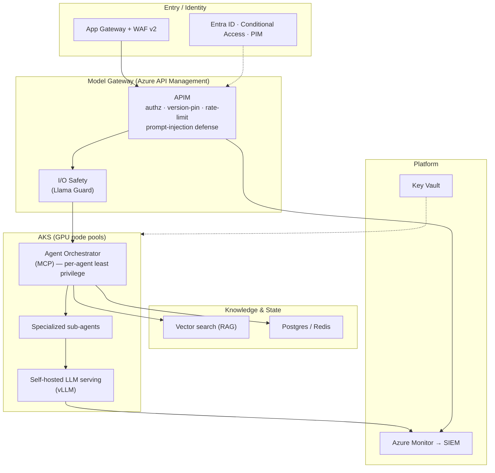

# Azure AI-Platform Reference Architecture

A reference pattern for running **production agentic AI on Microsoft Azure** — from self-hosted model serving to multi-agent orchestration, all on a Zero-Trust foundation and shipped as code.

This is a **vendor-neutral, customer-agnostic reference** distilled from real enterprise delivery. It documents *patterns and decisions*, not any specific deployment.

---

## Goals

- Serve open-weight LLMs **in your own tenant** (data residency, cost control) alongside frontier APIs.
- Put **every AI agent behind a governed gateway** — authorization, rate limiting, prompt-injection defense, audit.
- Make the platform **repeatable and reviewable**: everything as code, every environment identical.
- Keep it **enterprise-safe**: Zero-Trust networking, least-privilege identity, observability into a SIEM.

## Architecture

## Key components & decisions

| Layer | Choice | Why |
|---|---|---|
| **Model serving** | Self-hosted open-weight LLMs on **AKS GPU** via **vLLM** | Data stays in-tenant; predictable cost; falls back to frontier APIs where it pays off |
| **Agent layer** | **MCP** orchestrator → specialized sub-agents, each least-privilege | Tools/skills are governed and composable; blast radius is contained per agent |
| **Gateway** | **Azure API Management** as the single model gateway | One choke point for authz, version-pinning, rate-limiting, prompt-injection defense, and audit |
| **Guardrails** | I/O safety (e.g. **Llama Guard**) with a streaming-safety contract | Block unsafe input/output without breaking the streaming UX |
| **Retrieval** | **RAG** over vector search | Ground answers in enterprise knowledge; cite sources |
| **Networking** | Hub-spoke VNets · Private Endpoints / Private DNS · **Azure Firewall Premium** | Zero-Trust; no public data-plane exposure |
| **Identity** | **Entra ID** · Conditional Access · PIM · workload identity | Least-privilege, just-in-time access for humans *and* agents |
| **Delivery** | **Terraform (AVM)** + **Azure Landing Zone Accelerator** via Azure DevOps | Governed, repeatable prod/dev/test; reviewable change |
| **Observability** | Azure Monitor / Log Analytics → SIEM | Model drift, latency, cost, and security signals in one place |

## The agent ↔ LLM security model

The hard part of agentic AI in the enterprise isn't the model — it's **what an agent is allowed to do**. This pattern enforces:

1. **Every model call goes through the gateway** — no agent talks to a model (self-hosted or API) directly.
2. **Per-agent least privilege** — each sub-agent has its own identity, tools, and scoped permissions.
3. **Confirmation + audit on writes** — agents that mutate systems require human-in-the-loop gates and leave an audit trail.
4. **Input/output guardrails** — prompt-injection defense at the gateway, safety classification on I/O.

## Everything as code

- Terraform via **Azure Verified Modules (AVM)** + the **ALZ Accelerator**.
- Deployed through CI/CD (Azure DevOps); environments are identical and disposable.
- Network core, gateway, AKS, and policy all version-controlled and peer-reviewed.

---

> Authored by **Gustavo Norymberg** — AI & Agentic Platform Architect. A pattern reference, not a specific deployment. [LinkedIn](https://www.linkedin.com/in/gustavonorymberg)
